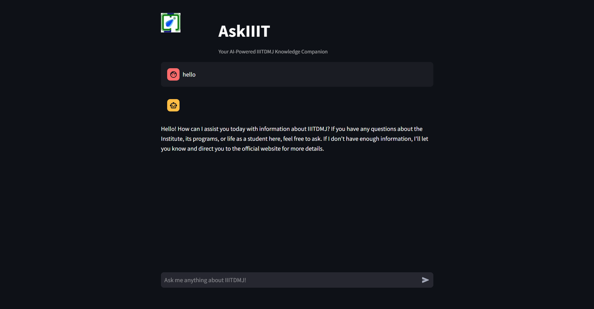
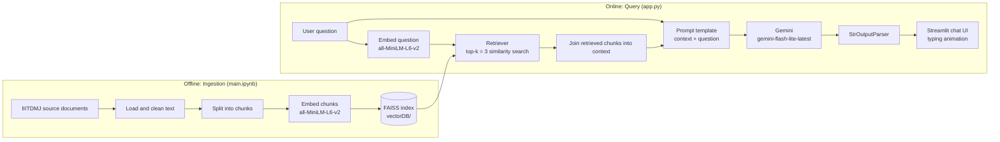

# RAG_ASK

> Your AI-Powered IIITDMJ Knowledge Companion

**Live demo:** [rag-ask.streamlit.app](https://rag-ask.streamlit.app/)

RAG_ASK is a Retrieval-Augmented Generation (RAG) chatbot that answers questions about **IIIT Jabalpur (IIITDMJ)**. Instead of letting an LLM answer from its own memory (where it can hallucinate college-specific facts), RAG_ASK first retrieves the most relevant passages from a curated IIITDMJ knowledge base and then asks the LLM to answer **only from those passages**.



---

## Table of Contents
1. [Why RAG?](#why-rag)
2. [Features](#features)
3. [Architecture](#architecture)
4. [Workflow in Detail](#workflow-in-detail)
5. [Design Decisions](#design-decisions)
6. [Assumptions](#assumptions)
7. [Limitations and Future Improvements](#limitations-and-future-improvements)
8. [Tech Stack](#tech-stack)
9. [Project Structure](#project-structure)
10. [Installation and Setup](#installation-and-setup)
11. [Usage](#usage)
12. [Rebuilding the Vector Store](#rebuilding-the-vector-store)
13. [Contributing](#contributing)
14. [License](#license)
15. [Author](#author)

---

## Why RAG?

A general-purpose LLM does not reliably know institute-specific details (departments, rules, facilities, people, procedures), and it will often produce confident but wrong answers. Fine-tuning a model for this would be costly and would go stale as soon as the institute updates anything.

RAG solves this by separating **knowledge** from **reasoning**:

- **Knowledge** lives in a vector database that can be rebuilt cheaply whenever the source documents change.
- **Reasoning** (reading the retrieved text and writing a clear answer) is done by the LLM.
- Answers are **grounded** in retrieved text, and the bot says so honestly when it has no information.

---

## Features

- 🤖 AI responses powered by Gemini (`gemini-flash-lite-latest`)
- 📚 Semantic retrieval over IIITDMJ documents (FAISS + sentence embeddings)
- 🛡️ Strictly context-grounded answers with a defined fallback when the context has no answer
- 💬 Chat interface with typing animation
- 🔄 Chat history kept for the duration of a browser session
- ⚡ Pre-built vector store included, so the app runs without any ingestion step

---

## Architecture

The system has two separate pipelines: an **offline ingestion pipeline** (run once, or whenever documents change) and an **online query pipeline** (run on every user question).



**Key point:** the same embedding model (`all-MiniLM-L6-v2`) must be used for both ingestion and querying. Vectors from different models are not comparable, so the question and the stored chunks have to live in the same embedding space.

---

## Workflow in Detail

### A. Offline: building the knowledge base (`main.ipynb`)

| Step | What happens |
|------|--------------|
| 1. Collect | IIITDMJ PDFs (academic guidelines, syllabus, course lists, M.Tech CSE curriculum, Ph.D. manual, the IIIT Act 2014, institute/hostel/club information, bus timetable, etc.) are placed in a local `IIITDMJ/` folder. |
| 2. Load | `DirectoryLoader` with `PyPDFLoader` reads every PDF page by page, so each page becomes one LangChain `Document` carrying its `source` file and `page` number as metadata. |
| 3. Chunk | `CharacterTextSplitter` splits the pages into small overlapping passages (see parameters below) so each chunk covers a focused piece of information and fits the embedding model's input size. |
| 4. Embed | Each chunk is converted into a dense vector using HuggingFace `all-MiniLM-L6-v2` (384-dimensional embeddings, runs locally, no API cost). |
| 5. Index | Vectors and their source text are stored in a **FAISS** index and saved to disk in `vectorDB/`. |

**Ingestion parameters**

| Parameter | Value |
|-----------|-------|
| Source documents | PDFs in `IIITDMJ/` (local folder, not part of the repository) |
| Loader | `DirectoryLoader(..., glob="./*.pdf", loader_cls=PyPDFLoader)` |
| Text splitter | `CharacterTextSplitter` with `separator="\n"` (splits on line breaks) |
| Chunk size | 300 characters |
| Chunk overlap | 200 characters |
| Total chunks indexed | 6,309 |
| Embedding model | `all-MiniLM-L6-v2` |
| Vector store | `FAISS.from_documents(...)`, saved with `save_local("vectorDB")` |

**How the splitter works:** `CharacterTextSplitter` cuts the text at newline characters and then merges consecutive lines until a chunk reaches about 300 characters. The 200-character overlap means each new chunk repeats the tail of the previous one, which helps keep sentences that fall on a boundary retrievable from either side. Because it only splits on one separator, it cannot break up a single very long line, and it has no notion of paragraphs or sentences.

> **Better alternative:** `RecursiveCharacterTextSplitter` tries a hierarchy of separators (paragraph break, then line break, then space, then single characters) and only falls back to the next one when a piece is still too large. This keeps paragraphs and sentences together far more often and never leaves an oversized chunk. See [Limitations and Future Improvements](#limitations-and-future-improvements).

### B. Online: answering a question (`app.py`)

1. **Startup.** `load_resources()` reads `GEMINI_API_KEY` from `.env`, creates the Gemini chat model, loads the embedding model, loads the FAISS index from `vectorDB/`, and builds the LangChain chain `prompt | chat | parser`. If the vector store fails to load, the UI shows an error instead of crashing.
2. **User asks a question** through the Streamlit chat input.
3. **Retrieval.** The question is embedded and FAISS returns the **top 3** most similar chunks (`search_kwargs={"k": 3}`).
4. **Context assembly.** The three chunks are joined with blank lines into a single `context` string.
5. **Prompt construction.** The context and question are injected into a strict system-style template (see below).
6. **Generation.** Gemini produces an answer using only the supplied context.
7. **Parsing.** `StrOutputParser` converts the model output into a plain string.
8. **Display.** The answer is shown with a character-by-character typing animation, and the (question, answer) pair is appended to `st.session_state["chat_history"]` so it is re-rendered on the next Streamlit rerun.

### The grounding prompt

The prompt is the main guard against hallucination. It tells the model to:

- act as `RAG_ASK`, an assistant specifically for IIITDMJ,
- base answers **strictly** on the provided context,
- not add information beyond the context,
- avoid assumptions and speculation,
- and, when the context does not cover the question, reply with a fixed fallback: *"I don't have enough information about this. Please visit www.iiitdmj.ac.in for more details."*

This makes the failure mode **"I don't know, here's the official site"** rather than **"confident wrong answer"**.

---

## Design Decisions

| Decision | Reasoning |
|----------|-----------|
| **RAG instead of fine-tuning** | Knowledge changes often; re-indexing documents is far cheaper and faster than retraining, and answers stay traceable to source text. |
| **`all-MiniLM-L6-v2` embeddings** | Small, fast, free, runs on CPU with no API calls, and gives good semantic search quality for English text. |
| **FAISS vector store** | Lightweight local similarity search with no separate database server; the index ships with the repo as a folder. |
| **Gemini `flash-lite` model** | Low latency and low cost, which suits a chatbot whose heavy lifting is done by retrieval rather than raw model capability. |
| **LangChain (LCEL chain)** | The `prompt \| model \| parser` pipeline keeps the generation step short, readable and easy to swap (different model, prompt or parser). |
| **Small overlapping chunks (300 chars, 200 overlap)** | Small chunks keep each embedding focused on one idea, and the heavy overlap reduces the chance that an answer is cut in half at a chunk boundary. The trade-off is duplication across chunks (see limitations). |
| **Top-k = 3** | A balance between giving the model enough context and keeping the prompt short and focused (less noise, lower cost and latency). |
| **Strict grounded prompt with fallback** | Prioritises trustworthiness over always answering. |
| **Streamlit** | Fast way to build a chat UI with built-in session state and chat components. |
| **Pre-built `vectorDB/` committed** | Anyone can clone and run the app immediately without running the ingestion notebook. |

---

## Assumptions

These are the assumptions the current design relies on:

1. **The knowledge base is the source of truth.** The bot can only be as correct and complete as the documents that were indexed. Anything outside them is out of scope by design.
2. **Documents are a snapshot.** The index reflects the data at build time; it does not auto-update when the institute's website or policies change.
3. **Questions are single-turn.** Each question is expected to be self-contained (see limitations about follow-ups).
4. **Top-3 chunks are enough** to answer a typical question. Questions needing information spread across many chunks may be answered incompletely.
5. **Queries are in English**, matching the embedding model and the documents.
6. **Semantic similarity is a good proxy for relevance.** The nearest chunks in embedding space are assumed to be the ones that contain the answer.
7. **The prompt is followed.** The model is trusted to obey the "answer only from context" rule; this is instruction-based, not enforced programmatically.
8. **The `vectorDB/` is trusted.** FAISS indexes are loaded with `allow_dangerous_deserialization=True` (the metadata is pickled), which is safe only because the index is built by the author and shipped in the repo. Never load an index from an untrusted source.
9. **A valid `GEMINI_API_KEY` is available** in the environment and the Gemini API is reachable.

---

## Limitations and Future Improvements

Being upfront about current trade-offs and where the project can go next:

| Current limitation | Possible improvement |
|--------------------|----------------------|
| **No conversational memory for the model.** Chat history is displayed in the UI but only the latest question is sent to the LLM, so follow-ups like "what about its fees?" lose context. | Add query rewriting / condense-question step using recent chat history. |
| **Resources are reloaded on every Streamlit rerun** (embedding model, FAISS index, chain). | Wrap `load_resources()` in `st.cache_resource` to load once per server process. |
| **Plain top-k similarity search**, with no relevance threshold or reranking. Low-quality matches can still be passed as context. | Add a similarity-score cut-off, MMR for diversity, hybrid (BM25 + vector) search, or a cross-encoder reranker. |
| **No source citations** shown to the user. | Return chunk metadata (document / page / URL) and display sources under each answer. |
| **Typing animation is cosmetic.** The full answer is generated first and then animated. | Use true token streaming from the model. |
| **Static knowledge.** Updating needs a manual notebook re-run. | Scheduled scraping / ingestion script and automated index rebuild. |
| **No automated evaluation.** | Build a small Q&A test set and measure retrieval hit-rate and answer faithfulness (e.g. with RAGAS-style metrics). |
| **English only.** | Multilingual embedding model for Hindi / mixed-language queries. |
| **Basic chunking.** `CharacterTextSplitter` splits only on newlines, and the 200/300 overlap is very high, so many chunks are near-duplicates of each other. With top-k = 3, duplicates can fill the retrieval slots and crowd out other useful passages. | Switch to `RecursiveCharacterTextSplitter` with larger chunks and smaller overlap (for example about 800-1000 characters with 100-150 overlap, which still fits the embedding model's roughly 256-token input limit), and compare retrieval quality before and after on a test set. |
| **Mixed-age source documents.** The corpus ranges from the 2014 IIIT Act to a 2024-25 course list, and some items (for example the bus timetable) are time-sensitive. | Record a "last updated" date per source document, show it with answers, and re-ingest periodically. |

---

## Tech Stack

| Layer | Technology |
|-------|------------|
| UI | Streamlit |
| LLM | Google Gemini (`gemini-flash-lite-latest`) via `langchain-google-genai` |
| Embeddings | HuggingFace `all-MiniLM-L6-v2` via `langchain-huggingface` |
| Vector store | FAISS (`langchain-community`) |
| Orchestration | LangChain (`ChatPromptTemplate`, `StrOutputParser`, LCEL chain) |
| Config | `python-dotenv`, `environs` |
| Language | Python |

---

## Project Structure

```
RAG_ASK/
├── app.py              # Streamlit app: loads resources, retrieval + generation, chat UI
├── main.ipynb          # Ingestion notebook: load docs, chunk, embed, build FAISS index
├── vectorDB/           # Pre-built FAISS vector store (loaded by app.py)
├── photo/
│   └── iiitdmjLOGO.jpeg  # Logo shown in the app header
├── screenshot.png      # UI screenshot used in this README
├── requirements.txt    # Python dependencies
├── commit.sh           # Git history rebuilder utility
├── .gitignore
├── LICENSE             # MIT license
└── README.md           # Project documentation
```

Create a local `.env` (not committed) for your API key.

---

## Installation and Setup

```bash
# 1. Clone the repository
git clone https://github.com/Omiyy/RAG_ASK.git
cd RAG_ASK

# 2. Create and activate a virtual environment
python -m venv .venv
.venv\Scripts\activate        # Windows
source .venv/bin/activate     # Linux / macOS

# 3. Install dependencies
pip install -r requirements.txt
```

Create a `.env` file in the project root:

```env
GEMINI_API_KEY=your_gemini_api_key_here
```

You can get a key from [Google AI Studio](https://aistudio.google.com/). Keep it private and never commit `.env`.

---

## Usage

```bash
streamlit run app.py
```

Open `http://localhost:8501` and ask questions about IIITDMJ. Questions the knowledge base cannot answer will return the fallback message pointing to the official website.

---

## Rebuilding the Vector Store

A pre-built `vectorDB/` is already included, so this step is optional. To rebuild it (for example after changing the source documents or chunking settings):

1. Put your source PDFs in a local folder named `IIITDMJ/` next to the notebook (the loader reads `IIITDMJ/*.pdf`; the PDFs are not included in this repository).
2. Run all cells of [`main.ipynb`](main.ipynb); it loads the PDFs, splits them into chunks, embeds them, and saves the FAISS index into `vectorDB/`.
3. Restart the Streamlit app.

Remember that the embedding model used here must match the one in `app.py` (`all-MiniLM-L6-v2`).

---

## Contributing

1. Fork the repository
2. Create your feature branch (`git checkout -b feature/AmazingFeature`)
3. Commit your changes (`git commit -m 'Add some AmazingFeature'`)
4. Push to the branch (`git push origin feature/AmazingFeature`)
5. Open a Pull Request

---

## License

This project is licensed under the MIT License. See the [LICENSE](LICENSE) file for details.

---

## Author

**Om Singhal**
B.Tech CSE (2023 batch), IIIT Jabalpur

- GitHub: [Omiyy](https://github.com/Omiyy)
- LinkedIn: [omsinghal852](https://www.linkedin.com/in/omsinghal852/)

## Acknowledgments

- IIITDMJ for providing institutional data
- Google Gemini for LLM API access
- LangChain community
- Streamlit team
- HuggingFace and the `sentence-transformers` project for the embedding model

---

Made with ❤️ at IIITDMJ
